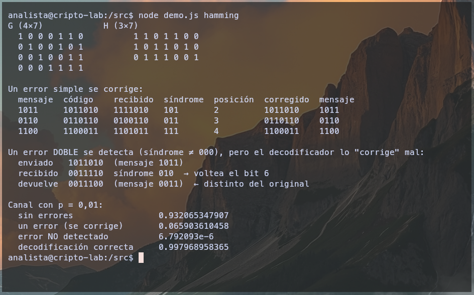
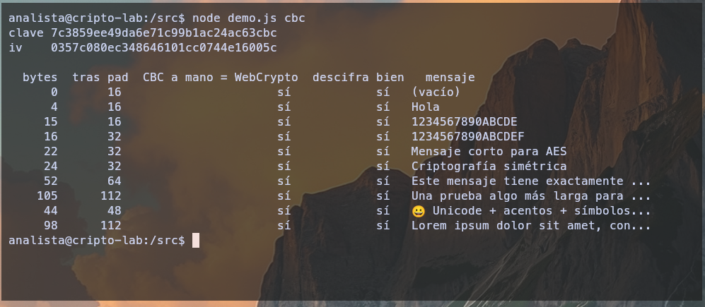
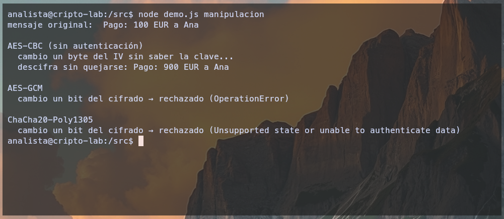
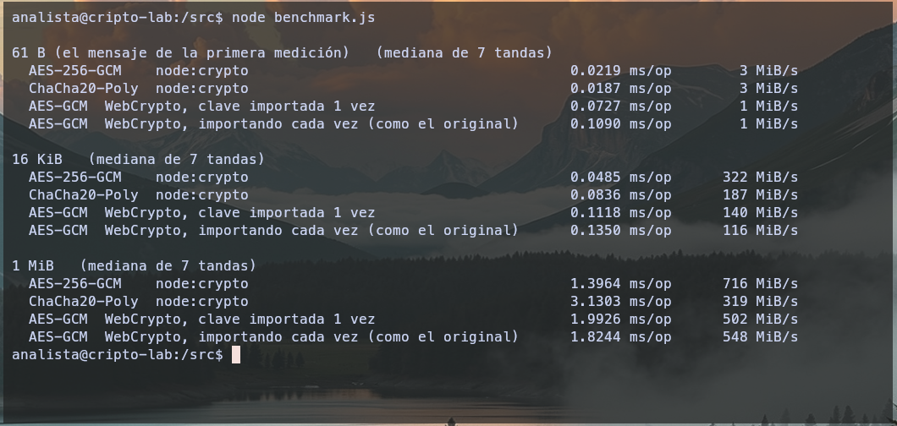
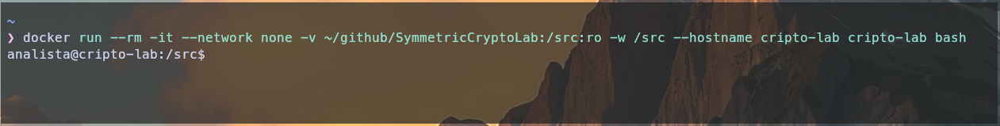
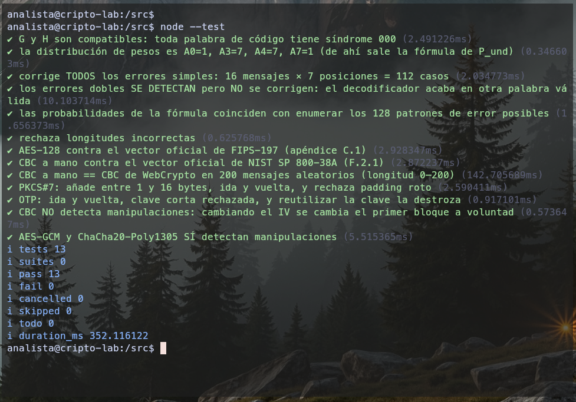

# SymmetricCryptoLab

Un código de **Hamming (7,4)** y varios mecanismos de **criptografía simétrica** en JavaScript: AES-CBC
escrito a mano contra el de WebCrypto, PKCS#7, OTP y cifrado autenticado con AES-GCM y ChaCha20-Poly1305.
Lo escribí yo y después le añadí las pruebas y un benchmark justo, para comprobar que lo que decía era
verdad.

Noviembre de 2026.

## Qué hay

| Fichero | Qué hace |
|---|---|
| [`hamming.js`](hamming.js) | matrices G y H, codificación, síndrome, corrección de un error y las probabilidades para un canal con `p` |
| [`symmetric_crypto.js`](symmetric_crypto.js) | AES-CBC a mano sobre bloques AES-ECB, PKCS#7, OTP, AES-GCM y ChaCha20-Poly1305 |
| [`run_all.js`](run_all.js) | ejecuta todo y vuelca un `output/results.json` |
| [`demo.js`](demo.js) | tres demos con salida legible: `hamming`, `cbc` y `manipulacion` |
| [`benchmark.js`](benchmark.js) | AES-GCM contra ChaCha20-Poly1305 con la misma vara de medir |
| [`tests/`](tests) | 13 pruebas con `node:test`, sin dependencias |

## Hamming (7,4)

Cuatro bits de mensaje, tres de redundancia. Con distancia mínima 3 corrige **un** error por palabra.
Las pruebas lo comprueban entero, no con tres ejemplos: los 16 mensajes por las 7 posiciones posibles
son **112 casos** y se corrigen todos.

Lo que más me interesó es lo que *no* hace. Un error doble tiene síndrome distinto de cero, así que se
**detecta**, pero el decodificador lo trata como si fuera simple, voltea un tercer bit y devuelve otra
palabra válida con otro mensaje. Las 336 combinaciones posibles de dos errores acaban así. Detectar y
corregir no son la misma cosa, y el código no avisa de cuándo se ha equivocado.

Las probabilidades también están verificadas: la fórmula con la distribución de pesos (`A0=1, A3=7,
A4=7, A7=1`) da lo mismo que enumerar los 128 patrones de error posibles. Con `p = 0,01`, la
probabilidad de un error no detectado es 6,79·10⁻⁶.



## Cifrado simétrico

- **AES-CBC a mano.** Cifro cada bloque con AES-ECB sin padding y encadeno yo con XOR. Coincide
  byte a byte con el CBC de WebCrypto en 200 mensajes aleatorios, y con el vector oficial de NIST
  SP 800-38A. El AES de bloque suelto, con el de FIPS-197.
- **PKCS#7**, y que rechace el padding roto.
- **OTP.** Funciona, pero si reutilizas la clave, `c1 XOR c2 = m1 XOR m2` y la clave desaparece de
  la ecuación. Hay una prueba que lo demuestra.
- **Manipulación.** CBC no autentica nada: cambiando un byte del IV, sin saber la clave, `Pago: 100 EUR`
  descifra sin error como `Pago: 900 EUR`. AES-GCM y ChaCha20-Poly1305 rechazan el mismo cambio.



```
node demo.js manipulacion
```



## Lo que no cuadraba

**El primer benchmark no era justo.** Salía ChaCha20 unas 12 veces más rápido que AES-GCM
(0,016 ms contra 0,195). Pero AES-GCM iba por WebCrypto, que es asíncrono y re-importaba la clave en
cada vuelta, y ChaCha por `node:crypto`, síncrono y con la clave ya hecha. Midiendo los dos por la misma
API, con clave de 256 bits, un nonce nuevo por operación y la mediana de 7 tandas intercaladas:

| Mensaje | AES-256-GCM | ChaCha20-Poly1305 | AES-GCM por WebCrypto, importando la clave cada vez |
|---|---|---|---|
| 61 B | 0,02 ms | 0,02 ms | 0,10–0,13 ms |
| 16 KiB | 0,045–0,048 ms | 0,08 ms | 0,12–0,26 ms |
| 1 MiB | 1,3–1,6 ms | 2,9–3,7 ms | 1,7–1,8 ms |

(cuatro pasadas, en un portátil con AES por hardware; los números exactos bailan, el orden de AES-GCM y
ChaCha con mensajes grandes no). WebCrypto en sí, con sus promesas, cuesta de 3 a 6 veces más que
`node:crypto` con 61 B, y re-importar la clave cada vez lo empeora a veces (en otras pasadas no se nota).
Con mensajes pequeños empatan y a partir de unos KiB gana AES-GCM. Buena parte de la diferencia de la primera
medición era el método de medir, no los algoritmos. ChaCha20 está pensado para ganar donde no hay AES por
hardware; ese caso no lo he medido.



Otras dos cosas, que dejé tal cual en el código:
- El mensaje de prueba «Este mensaje tiene exactamente treinta y dos bytes!!» mide **52**.
- El benchmark original reutilizaba el mismo IV de GCM en las 300 iteraciones. Ahí es inofensivo, pero con
  GCM repetir el nonce es de los peores errores posibles. Es el mismo problema que en
  [EcdsaNonceAttack](https://github.com/avidosa/EcdsaNonceAttack), con otro algoritmo.

## Cómo ejecutarlo

No hace falta tener Node: va en Docker, sin red y con el repo en solo lectura.

```
docker build -t cripto-lab .
docker run --rm --network none -v "$PWD":/src:ro -w /src cripto-lab node --test
docker run --rm --network none -v "$PWD":/src:ro -w /src cripto-lab node demo.js hamming
docker run --rm --network none -v "$PWD":/src:ro -w /src cripto-lab node benchmark.js
```

Con Node instalado (lo probé con la 24): `npm test`.





## Límites

Es código para aprender, no para usar. El CBC a mano existe para ver cómo funciona: en la vida real se usa
un modo autenticado. Además `pkcs7Unpad` protesta de forma distinta según qué falle y no es de tiempo
constante, justo lo que hace falta para un *padding oracle* si alguien lo expusiera en un servicio. Y el
OTP solo es seguro con una clave de un solo uso, que aquí queda en manos de quien llame a la función.
